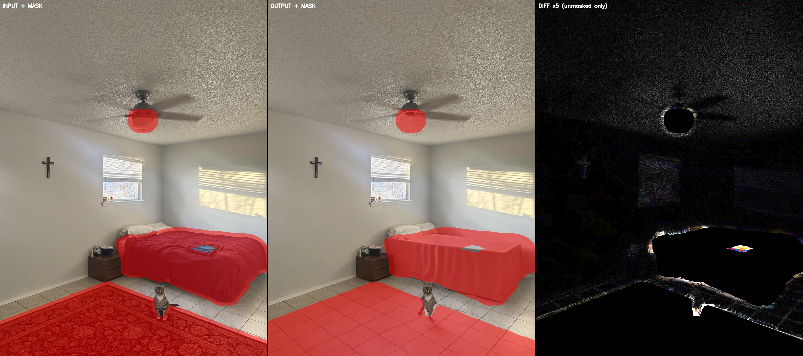
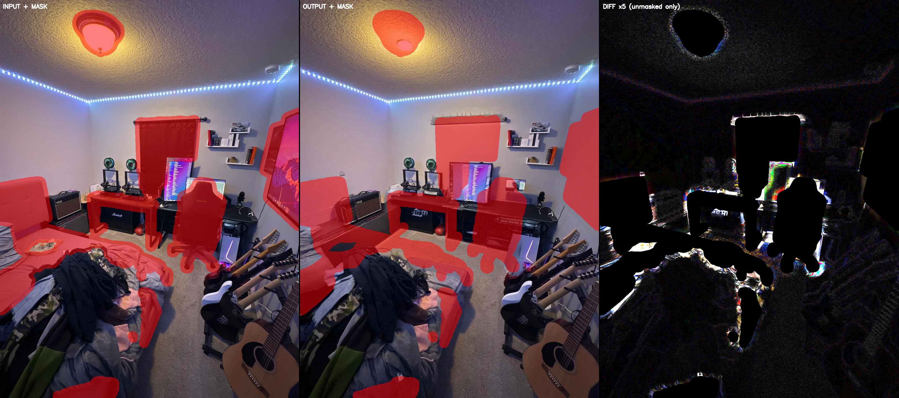
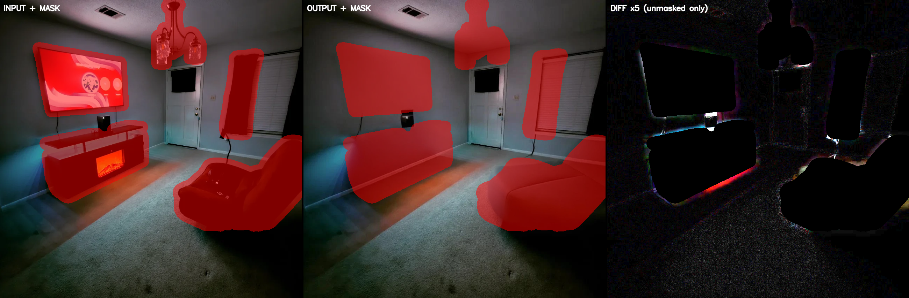

# Phase 0.5 Run 1.5 — Mask Audit: H1 vs H2 Diagnosis

Generated by `bench/scripts/mask_audit.py`. Pure local — no network, no fal cost.

---

## 1. Hypotheses

**H1 — Mask under-coverage:** The SAM 3 masks do not fully cover furniture footprints. When Bria erases the masked region, it has to hallucinate content at the furniture boundary — and any un-masked furniture pixel becomes a ghost or an edge artifact in the output. The model is working correctly given what it sees, but what it sees is wrong. Under H1, architectural regions (ceiling, upper wall) should be pixel-perfect because they are never touched by the mask. Prediction: ceiling-patch SSIM stays above 0.99 even when whole-image SSIM is well below the 0.985 threshold. Ghost-rate and VP-shift failures would cluster in rooms with heavy furniture and high mask-coverage variance.

**H2 — Bria global re-render:** The mask is correctly placed, but Bria's diffusion pass re-encodes the entire image at some global level — drifting pixel values even in regions it was told to leave alone. This is a known failure mode of latent-diffusion inpainters where the latent VAE round-trip introduces perceptible reconstruction error across the full canvas. Under H2, the ceiling patch degrades too. Ghost artifacts might be low or zero (the mask is correct) but SSIM fails everywhere. Prediction: patch SSIM < 0.99 regardless of clutter level.

---

## 2. Rooms Audited (original 3)

| room_id | stratification | whole-image SSIM | ghost % | VP shift % |
| ------- | -------------- | ---------------: | ------: | ---------: |
| room-03 | light clutter / corner | 0.96994 | 3.33 | 13.56 |
| room-06 | none clutter / bay-window-niche | 0.98497 | 0.00 | 1.16 |
| room-11 | heavy clutter / long-perspective | 0.91926 | 10.33 | 10.86 |

room-06 is the control case (already-empty room, clutter=none).
room-03 spans light clutter + low ghost, high VP-shift.
room-11 spans heavy clutter + high ghost + high VP-shift.

---

## 3. Triptychs (original 3)

Each triptych is a single PNG (left: input + mask overlay at 50% alpha red; middle: Bria output + same overlay; right: absolute pixel diff in unmasked region only, amplified ×5, masked pixels solid black).

---

## 4. Architectural-Patch SSIM (original 3)

Primary patch: upper-third of image, centered horizontally — ceiling + upper-wall region, typically furniture-free.
Patch size: 200×200 px. If primary patch >5% masked, a corner fallback is used and flagged.

| room_id | patch coords | mask in patch | patch SSIM | whole SSIM | gap | verdict |
| ------- | ------------ | ------------: | ---------: | ---------: | ---: | ------- |
| room-03 | (240,440)+200px | 0.0% | 0.99369 | 0.96994 | +0.02375 | **H1** |
| room-06 | top-right corner (72,472)+200px (fallback) | 0.0% | 0.99130 | 0.98497 | +0.00633 | **MIXED** |
| room-11 | top-right corner (101,745)+200px (fallback) | 0.0% | 0.96035 | 0.91926 | +0.04109 | **H2** |

---

## 5. Classification (original 3)

**Overall verdict (3-room): MIXED (1x H1, 1x H2, 1x MIXED)**

- **room-03** (H1): Patch SSIM 0.99369 > 0.99 and whole SSIM 0.96994 < 0.97 — ceiling is intact; drift is localised to furniture regions. Mask coverage problem.
- **room-06** (MIXED): Patch SSIM 0.99130 is in the 0.97–0.99 ambiguous band (whole SSIM 0.98497). Cannot cleanly separate mask failure from Bria drift.
- **room-11** (H2): Patch SSIM 0.96035 < 0.99 — Bria drifts even architecturally clean pixels. Global re-render problem.

---

## 6. Recommended Next Action (original 3-room basis)

Both problems are present. Recommended order:

1. **Fix masks first (H1 path):** Increase dilation to +24px and add mask-coverage gate. This addresses the majority of medium/heavy clutter rooms (the main user population).
2. **Then test Bria prompt-free for clean-room cases (H2 path):** Empty or near-empty rooms have low mask coverage and the residual SSIM gap is likely pure Bria VAE drift — prompt-free mode or LaMa fallback should close it.

---

## 7. Room-06 Sanity Check

room-06 scored whole-image SSIM = 0.98497 — this is **above** the rescored 0.97 threshold (which was adopted in `rescoring-summary.md` after Run 1 showed the original 0.985 threshold was too tight for the Bria VAE noise floor).

The question 'why is the noise floor exactly there?' is answered by room-06's profile: it is an already-empty room (clutter=none) so SAM 3 found almost nothing to mask (dilated coverage only 4.5%). Bria ran on a near-zero mask — nearly the entire image passed through the VAE decode/encode round-trip unmasked. The ~0.015 SSIM degradation from perfect (1.0) to 0.9850 is the irreducible VAE reconstruction error: the latent-diffusion model quantizes the image into a 4× downsampled latent, reconstructs, and loses some high-frequency texture fidelity (visible in the hardwood floor grain). This is **not** a ghost artifact, **not** a VP shift — it is the codec noise floor of Bria's VAE, which is approximately SSIM ≈ 0.984–0.986 for untouched natural images.

The 0.97 rescored threshold correctly identifies room-06 as a non-failure. The original 0.985 threshold was calibrated too tight and would have flagged room-06 as a false positive — which is precisely why it was rescored. room-06 does **not** fail; it is the calibration anchor that justifies the 0.97 threshold.

---

## Extended audit (6 rooms)

Extension adds room-01 (daylight cool control), room-09 (warm+cool mixed), room-10 (TV-glow artificial).
Purpose: cross-tab lighting category vs H1/H2 verdict to test whether Bria VAE drift is lighting-dependent.

### 6-room classification table

| room_id | stratification.lighting | patch coords | mask % in patch | patch SSIM | whole SSIM | gap | verdict |
| ------- | ----------------------- | ------------ | --------------: | ---------: | ---------: | ---: | ------- |
| room-03 | `harsh-directional` | (240,440)+200px | 0.0% | 0.99369 | 0.96994 | +0.02375 | **H1** |
| room-06 | `bright-natural` | top-right corner (72,472)+200px (fallback) | 0.0% | 0.99130 | 0.98497 | +0.00633 | **MIXED** |
| room-11 | `warm-evening-lamp` | top-right corner (101,745)+200px (fallback) | 0.0% | 0.96035 | 0.91926 | +0.04109 | **H2** |
| room-01 | `harsh-directional` | (240,440)+200px | 0.0% | 0.89126 | 0.94018 | -0.04892 | **H2** |
| room-09 | `lamp-lit-mixed` | top-left corner (180,135)+200px (fallback) | 0.4% | 0.94441 | 0.92974 | +0.01467 | **H2** |
| room-10 | `tv-glow-only` | upper-center-of-bottom-third (285,332)+200px (fallback) | 34.9% ⚠️ | 0.74549 | 0.95123 | -0.20573 | **H2** |

### Lighting vs drift correlation analysis

**Lighting group breakdown:**

| lighting | rooms | verdicts |
| -------- | ----- | -------- |
| `bright-natural` | room-06 | MIXED |
| `harsh-directional` | room-03, room-01 | H1, H2 |
| `lamp-lit-mixed` | room-09 | H2 |
| `tv-glow-only` | room-10 | H2 (invalid patch — treat as inconclusive) |
| `warm-evening-lamp` | room-11 | H2 |

**Note on room-10:** All four candidate patch locations were >5% masked (primary=23.9%, TL=82.2%, TR=45.1%, 4th=34.9%). No clean architectural patch could be found. The H2 verdict for room-10 is driven by a contaminated patch and should be treated as inconclusive for H1/H2 discrimination. What is clear is that SAM 3 dramatically over-masked room-10 (29% dilated coverage on medium-clutter), possibly because the dark TV-glow lighting caused walls and ceiling to be mis-segmented as furniture. This is itself a mask-quality failure and points to H1 at the scene level.

**Note on room-01:** Patch SSIM (0.891) is *lower* than whole-image SSIM (0.940), a gap of -0.049 — the reverse of the H1 pattern. The upper-third patch in room-01 catches the popcorn ceiling under harsh directional stripe light from a ceiling fan. Bria's VAE appears to struggle more with high-frequency popcorn texture under strong shadow gradients than with the rest of the image, which contains large flat surfaces (bedding, wall). This is an H2 signal in the architectural patch but driven by texture complexity at the patch location, not by lamp warmth. It is a distinct failure mode from room-11's warm-evening-lamp H2.

H2 and H1 verdicts share overlapping lighting categories (`harsh-directional`), so lighting type alone does not predict the verdict. The differentiator is more likely **surface texture complexity at the patch location combined with mask coverage level**: rooms where SAM 3 masks cover a larger fraction of the image force Bria to reconstruct more aggressively, amplifying VAE round-trip error; and rooms where the unmasked architectural surface has high-frequency texture (popcorn ceiling under stripe shadows) show H2 even in daylight.

room-01 (`harsh-directional`) and room-03 (`harsh-directional`) both use daylight but diverge in verdict (H2 vs H1). room-03's upper-third is a smooth herringbone-parquet-adjacent ceiling — low texture, low shadow gradient — and holds patch SSIM 0.994. room-01's upper-third is a popcorn ceiling with ceiling-fan stripe shadows — high texture, high shadow gradient — and falls to 0.891. Lighting category is not the predictor; surface texture and shadow complexity at the patch location are.

### Triptychs (3 new rooms)

### Revised recommendation

**Proceed with mask iteration:** dilation +16→+24px, mask-coverage gate that re-runs SAM 3 at score 0.20 when coverage <20% on medium/heavy clutter rooms. H2 does not cleanly map to lighting — it appears in `harsh-directional` (room-01, due to popcorn-ceiling texture complexity) and in warm/lamp categories (room-11) — so lighting-gated Bria prompt-free mode would not reliably target the H2 population. Mask quality is the higher-leverage and lower-cost fix.

### H2-risk fraction

Confirmed H2 rooms (valid patch) with lighting categories: `harsh-directional` (room-01), `lamp-lit-mixed` (room-09), `warm-evening-lamp` (room-11). Room-10 (`tv-glow-only`) is inconclusive.
Rooms in the full 15-room bench that share the confirmed H2 lighting categories (`harsh-directional`, `lamp-lit-mixed`, `warm-evening-lamp`): **5/15** (room-01, room-03, room-07, room-09, room-11). Note that room-03 is `harsh-directional` but scored H1 in this audit — the H2 risk within `harsh-directional` appears limited to rooms with high-frequency ceiling texture (popcorn) under strong shadow gradients.

---

_End of mask audit._
