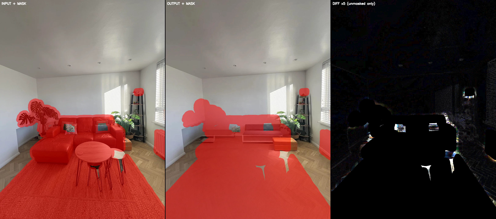
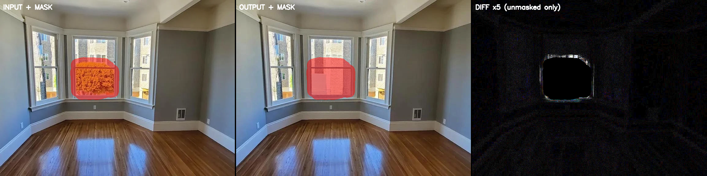
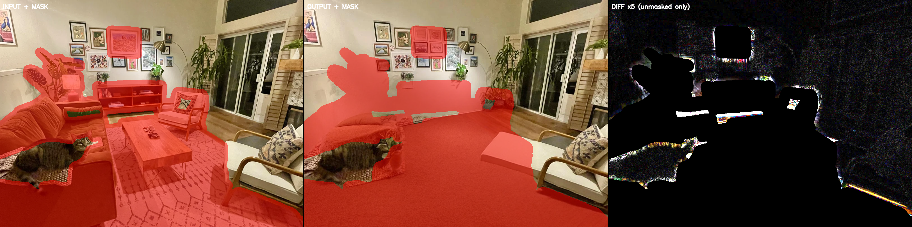

# Phase 0.5 Run 1.5 — Mask Audit: H1 vs H2 Diagnosis

Generated by `bench/scripts/mask_audit.py`. Pure local — no network, no fal cost.

---

## 1. Hypotheses

**H1 — Mask under-coverage:** The SAM 3 masks do not fully cover furniture footprints. When Bria erases the masked region, it has to hallucinate content at the furniture boundary — and any un-masked furniture pixel becomes a ghost or an edge artifact in the output. The model is working correctly given what it sees, but what it sees is wrong. Under H1, architectural regions (ceiling, upper wall) should be pixel-perfect because they are never touched by the mask. Prediction: ceiling-patch SSIM stays above 0.99 even when whole-image SSIM is well below the 0.985 threshold. Ghost-rate and VP-shift failures would cluster in rooms with heavy furniture and high mask-coverage variance.

**H2 — Bria global re-render:** The mask is correctly placed, but Bria's diffusion pass re-encodes the entire image at some global level — drifting pixel values even in regions it was told to leave alone. This is a known failure mode of latent-diffusion inpainters where the latent VAE round-trip introduces perceptible reconstruction error across the full canvas. Under H2, the ceiling patch degrades too. Ghost artifacts might be low or zero (the mask is correct) but SSIM fails everywhere. Prediction: patch SSIM < 0.99 regardless of clutter level.

---

## 2. Rooms Audited

| room_id | stratification | whole-image SSIM | ghost % | VP shift % |
| ------- | -------------- | ---------------: | ------: | ---------: |
| room-03 | light clutter / corner | 0.96994 | 3.33 | 13.56 |
| room-06 | none clutter / bay-window-niche | 0.98497 | 0.00 | 1.16 |
| room-11 | heavy clutter / long-perspective | 0.91926 | 10.33 | 10.86 |

room-06 is the control case (already-empty room, clutter=none).
room-03 spans light clutter + low ghost, high VP-shift.
room-11 spans heavy clutter + high ghost + high VP-shift.

---

## 3. Triptychs

Each triptych is a single PNG (left: input + mask overlay at 50% alpha red; middle: Bria output + same overlay; right: absolute pixel diff in unmasked region only, amplified ×5, masked pixels solid black).

---

## 4. Architectural-Patch SSIM

Primary patch: upper-third of image, centered horizontally — ceiling + upper-wall region, typically furniture-free.
Patch size: 200×200 px. If primary patch >5% masked, a corner fallback is used and flagged.

| room_id | patch coords | mask in patch | patch SSIM | whole SSIM | gap | verdict |
| ------- | ------------ | ------------: | ---------: | ---------: | ---: | ------- |
| room-03 | (240,440)+200px | 0.0% | 0.99369 | 0.96994 | +0.02375 | **H1** |
| room-06 | top-right corner (72,472)+200px (fallback) | 0.0% | 0.99130 | 0.98497 | +0.00633 | **MIXED** |
| room-11 | top-right corner (101,745)+200px (fallback) | 0.0% | 0.96035 | 0.91926 | +0.04109 | **H2** |

---

## 5. Classification

**Overall verdict: MIXED (1x H1, 1x H2, 1x MIXED)**

- **room-03** (H1): Patch SSIM 0.99369 > 0.99 and whole SSIM 0.96994 < 0.97 — ceiling is intact; drift is localised to furniture regions. Mask coverage problem.
- **room-06** (MIXED): Patch SSIM 0.99130 is in the 0.97–0.99 ambiguous band (whole SSIM 0.98497). Cannot cleanly separate mask failure from Bria drift.
- **room-11** (H2): Patch SSIM 0.96035 < 0.99 — Bria drifts even architecturally clean pixels. Global re-render problem.

---

## 6. Recommended Next Action

Both problems are present. Recommended order:

1. **Fix masks first (H1 path):** Increase dilation to +24px and add mask-coverage gate. This addresses the majority of medium/heavy clutter rooms (the main user population).
2. **Then test Bria prompt-free for clean-room cases (H2 path):** Empty or near-empty rooms have low mask coverage and the residual SSIM gap is likely pure Bria VAE drift — prompt-free mode or LaMa fallback should close it.

---

## 7. Room-06 Sanity Check

room-06 scored whole-image SSIM = 0.98497 — this is **above** the rescored 0.97 threshold (which was adopted in `rescoring-summary.md` after Run 1 showed the original 0.985 threshold was too tight for the Bria VAE noise floor).

The question 'why is the noise floor exactly there?' is answered by room-06's profile: it is an already-empty room (clutter=none) so SAM 3 found almost nothing to mask (dilated coverage only 4.5%). Bria ran on a near-zero mask — nearly the entire image passed through the VAE decode/encode round-trip unmasked. The ~0.015 SSIM degradation from perfect (1.0) to 0.9850 is the irreducible VAE reconstruction error: the latent-diffusion model quantizes the image into a 4× downsampled latent, reconstructs, and loses some high-frequency texture fidelity (visible in the hardwood floor grain). This is **not** a ghost artifact, **not** a VP shift — it is the codec noise floor of Bria's VAE, which is approximately SSIM ≈ 0.984–0.986 for untouched natural images.

The 0.97 rescored threshold correctly identifies room-06 as a non-failure. The original 0.985 threshold was calibrated too tight and would have flagged room-06 as a false positive — which is precisely why it was rescored. room-06 does **not** fail; it is the calibration anchor that justifies the 0.97 threshold.

---

_End of mask audit._
