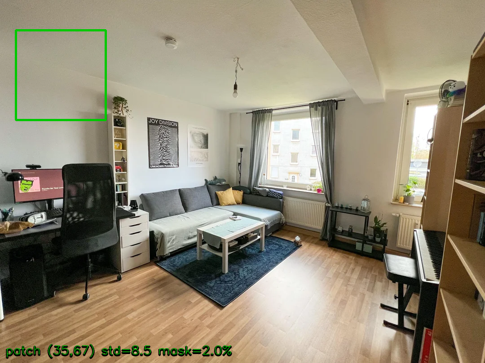
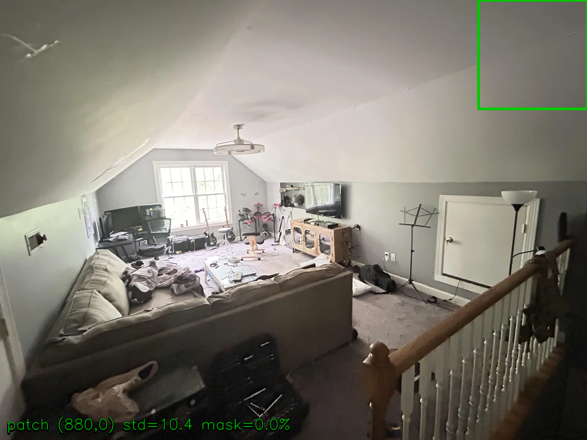
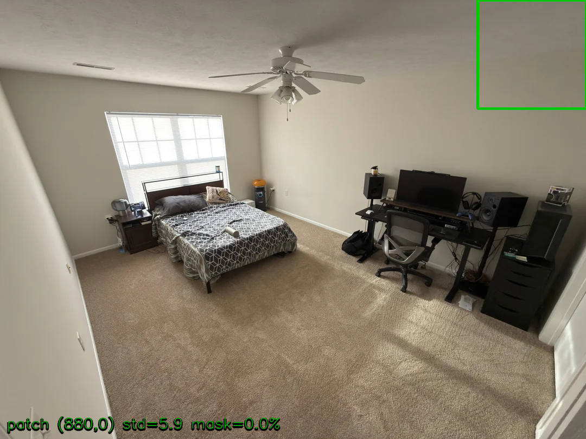
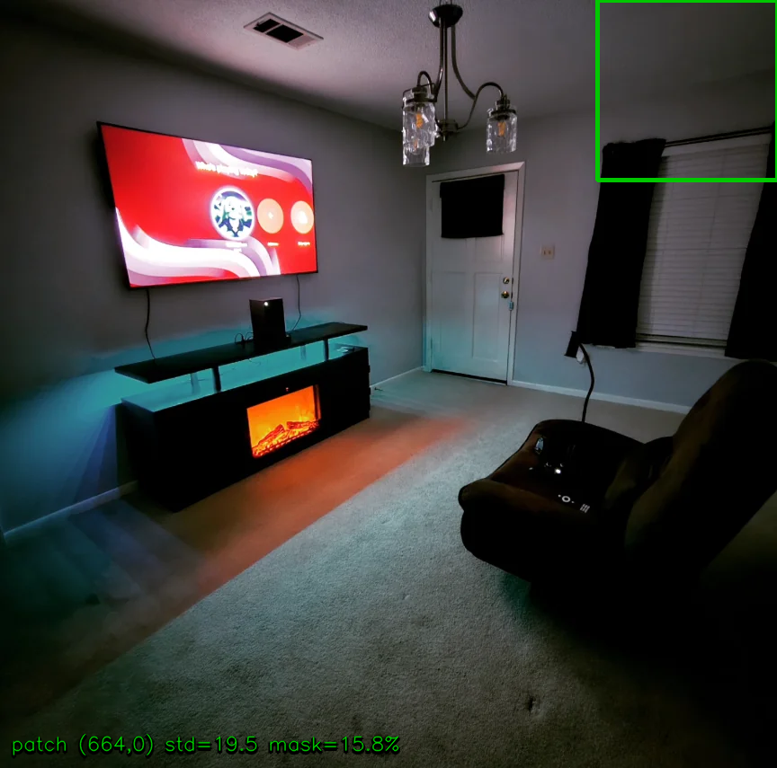
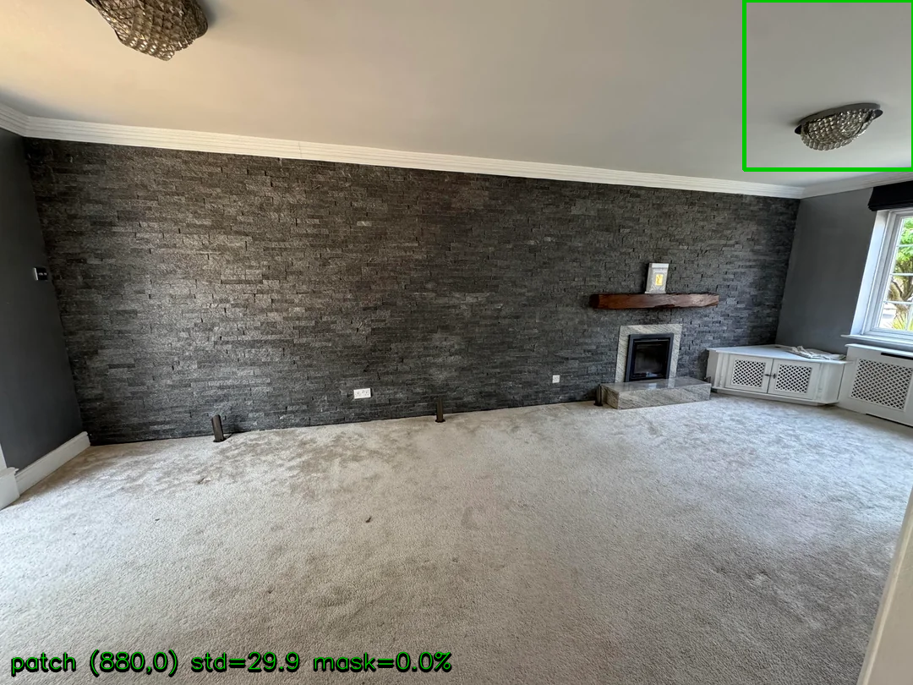

# 5-Room LaMa Architectural-Patch Audit

**Phase:** 0.5 — Run 3 SSIM failure diagnosis
**Date:** 2026-04-20
**Cost:** $0 (pure local computation)

## 1. Identified Rooms

Rooms with `inpainter == lama` AND `metrics.ssim_unmasked < 0.97` in Run 3:

| Room | Whole SSIM (unmasked) |
|---|---|
| room-02 | 0.7145 |
| room-04 | 0.8611 |
| room-07 | 0.7048 |
| room-10 | 0.9222 |
| room-14 | 0.4302 |

## 2. Per-Room Patch Analysis

Patch size: 200×200 px, selected from upper-third region, mask overlap < 5% preferred (lowest texture std among qualifying candidates).

| Room | Patch (x,y) | Mask % in patch | Texture std | Whole SSIM | Patch SSIM | Gap | Classification |
|---|---|---|---|---|---|---|---|
| room-02 | (35,67) | 2.0% | 8.5 | 0.7145 | 0.9123 | +0.1979 | **Real drift** |
| room-04 | (880,0) | 0.0% | 10.4 | 0.8611 | 0.9970 | +0.1359 | **Measurement artifact** |
| room-07 | (880,0) | 0.0% | 5.9 | 0.7048 | 0.9982 | +0.2934 | **Measurement artifact** |
| room-10 | (664,0) | 15.8% | 19.5 | 0.9222 | 0.9057 | -0.0165 | **Inconclusive (no clean patch)** *(no clean patch)* |
| room-14 | (880,0) | 0.0% | 29.9 | 0.4302 | 0.9342 | +0.5040 | **Real drift** |

**Classification key:**
- Patch SSIM < 0.98 → **Real drift**
- Patch SSIM ≥ 0.99 → **Measurement artifact** (clean architecture preserved; whole-image drift concentrated in mask-boundary / preserved-furniture pixels)
- 0.98 ≤ patch SSIM < 0.99 → **Inconclusive**
- No candidate with mask overlap < 5% → **Inconclusive (no clean patch)**

## 3. Patch Visualizations

Green box = chosen 200×200 architectural patch. Caption shows location, texture std, and mask overlap.

### room-02

### room-04

### room-07

### room-10

### room-14

## 4. Aggregate Verdict

**Verdict: C**

Per-room split: room-02: Real drift; room-04: Measurement artifact; room-07: Measurement artifact; room-10: Inconclusive (no clean patch); room-14: Real drift. Recommend: treat artifact rooms as metric-stack issues (revise gate to patch SSIM); investigate real-drift rooms individually for texture/lighting correlation.

- Measurement artifact: 2/5
- Real drift: 2/5
- Inconclusive: 1/5

**Recommendation:** Split handling: apply patch-SSIM gate for artifact rooms; run targeted inpainter ablation for real-drift rooms.

## 5. Cost Reconciliation

| Item | Cost |
|---|---|
| Local SSIM computation (skimage, cv2) | $0.00 |
| Network calls | $0.00 |
| **Total** | **$0.00** |

